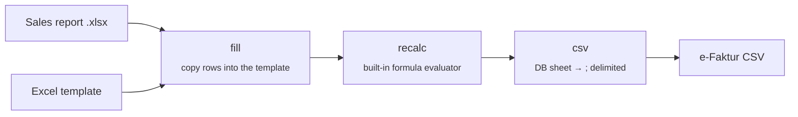
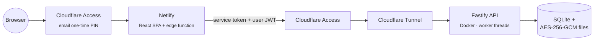

<div align="center">


# VAT

**Turn a monthly sales export into an e-Faktur CSV that's ready to upload.**

No Microsoft Excel required, with output that matches the desktop app byte for byte.

[](https://vat.stanleyowen.com)
[](https://github.com/stanleyowen/vat/releases/latest)
[](LICENSE.txt)

</div>

---

## What it does

Indonesian VAT reporting through e-Faktur takes a semicolon-delimited CSV in a fixed layout. Most accounting systems only export an Excel sales report, and the usual bridge between the two is an Excel template full of formulas that someone has to open, recalculate and save by hand every month.

VAT automates that step:

1. **Upload** the exported sales report (`.xlsx`).
2. **Pick a template**: your own Excel workbook that maps report rows to e-Faktur fields.
3. **Download** the finished CSV, along with a summary of the invoice count, DPP and PPN.

Every conversion is kept in an encrypted history, so you can download it again later.

## How it works



The desktop app needed Excel to recalculate the template. The web version replaces that step with its own formula engine (`server/src/engine/`). It's a pure function that implements exactly the functions the templates use and reproduces the Excel behaviour that affects the numbers:

| Behaviour | What the engine does |
|---|---|
| Text dates | Parsed as day/month/year (checked against past outputs) |
| Number → text | 15 significant digits, as in Excel |
| Blank cell reference | Evaluates to `0` |
| Text comparison | Case-insensitive |
| `ROUND` | Rounds the decimal value, not the binary float |

The engine never approximates. A template that uses an unsupported formula is **rejected when you upload it**, so a wrong number never reaches the output. A parity harness compares the engine against real historical Excel outputs.

## Architecture



- **Sign-in** goes through Cloudflare Access only. There are no app passwords and no sessions. The API checks both the user's and the proxy's Access JWTs, and the email must also be on a server-side allow-list.
- **Conversions** run in worker threads with heap and time limits. Uploaded zip files are size-checked as they're unpacked, and CSV values that would break the format are refused.
- **Storage** is SQLite plus files encrypted at rest with AES-256-GCM, bound to their record.

## Repository layout

```
web/        Vite + React + Tailwind front end, plus the Netlify edge proxy
server/     Node + Fastify API, the conversion engine and its tests
deploy/     Cloudflare Access setup and the server auto-deploy script
src/, public/   Legacy Electron desktop app ("Output VAT")
```

## Development

Requires Node 24+.

```bash
# API on :8080. Access checks are off outside production.
cd server && npm install && npm run dev

# Front end on :5173, proxies /api to the API
cd web && npm install && npm run dev
```

```bash
cd server
npm test              # unit, API and security tests
npm run typecheck
docker build --target test .   # run the tests inside Linux
```

Deployment, secrets and day-to-day operations are covered in **[DEPLOY.md](DEPLOY.md)**. Pushing to `main` deploys both halves: Netlify builds the front end, and the server pulls, tests and redeploys the API every night.

## Desktop app (legacy)

The original **Output VAT** is an Electron app that fills the template, has a local copy of Excel recalculate it through a user-supplied script, and writes the CSV. It is still available from [Releases](https://github.com/stanleyowen/vat/releases) for Windows, macOS and Linux, but new work happens in the web version.

```bash
yarn install
yarn dev    # CRA dev server + Electron
```

## License

[Apache 2.0](LICENSE.txt)
